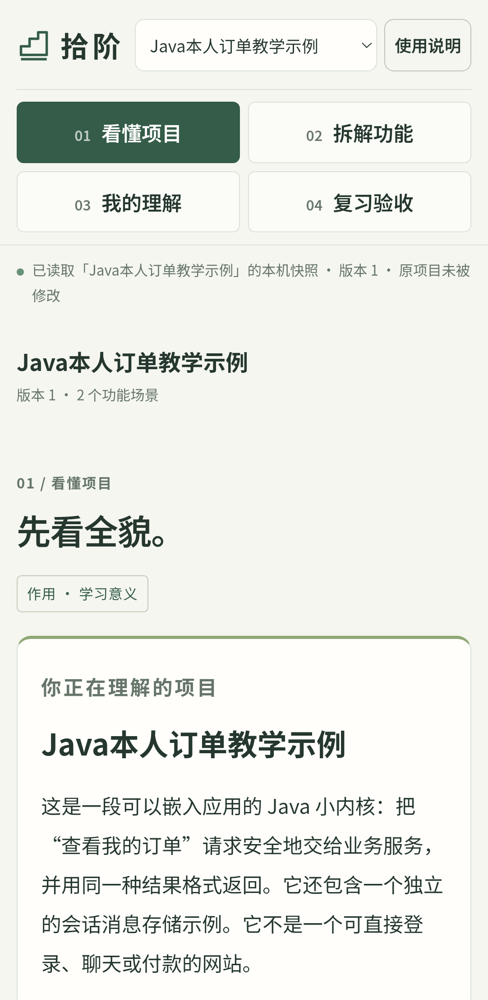
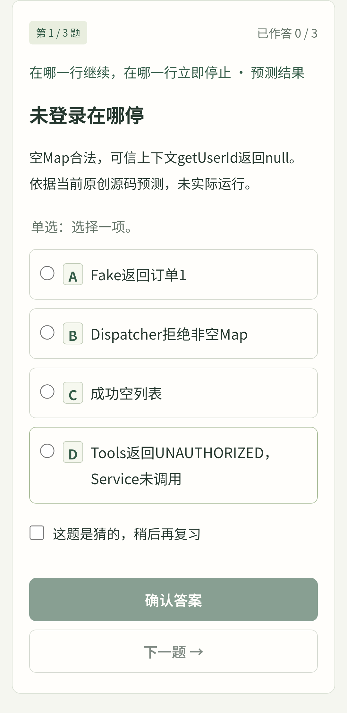

# 拾阶

做过一个项目，也能把它说清楚。

拾阶从使用者自己的项目与资料整理学习内容，按 **看懂项目 → 拆解功能 → 我的理解 → 复习验收** 使用。讲解先展示功能和调用顺序，再追踪正常与非法输入的类型、值、来源和停止位置；源码是可展开的依据。

本目录是独立应用，与仓库根目录的拾知分别启动、分别保存记录。拾知继续负责原来的学习计划、资料、AI 草稿与刷题。本项目使用 **OpenAI Codex** 协作完成，维护者负责需求、方向、审阅和发布。

| 看懂项目 | 逐题复习 |
| --- | --- |
|  |  |

Android 模拟器内实际运行的原创示例截图。

## 在手机上使用

在 [Releases](https://github.com/chaosmakerw/codesprint-studio/releases) 下载 `shijie-0.4.1-sample.apk`，安装到 Android 8.0 或以上设备。首次打开包含 Java 本人订单和 Python 笔记任务队列两个原创示例，合计 31 道客观题。

页面、讲义、题目均在安装包中，学习记录保存到手机应用自己的 IndexedDB，电脑关闭也能学习。正式应用没有联网或广泛存储权限，备份导入与导出使用系统文件选择器。手机不会运行 Agent 或扫描电脑项目。

卸载、清除数据或换手机前，先在使用说明中导出完整备份。备份恢复会替换当前学习内容与记录，应先留存原数据。备份没有加密，分享前确认允许他人阅读其中的源码、资料和回答。

## 在电脑上使用

需要 Python 3.12+。保留完整本目录，Windows 双击 `START.cmd`，或者运行：

```text
python run.py --open
```

默认本机地址为 `http://127.0.0.1:8769`，学习时保留服务窗口。再次启动同一应用会打开正在运行的服务；端口冲突使用 `START.cmd --port 8771`，不会关闭其他程序。数据保存在本目录 `data/`，不进入 Git。

桌面首次为空库，可以从使用说明体验原创 Java 或 Python 示例，或让自己的 Agent 准备内容。

## 把自己的项目交给 Agent

读取 [首次准备](prompts/first-run.md)、[持续补充](prompts/project-coach.md) 和[数据协议](prompts/reference.md)。使用者授权后，外部 Agent 只读检查项目与资料，通过“预览校验 → 核对 → 提交”准备调用链、知识讲义和有依据的题目。

应用自身不连接模型账号，不自动搜索或发送源码。资料不足时，由使用者明确授权自己的 Agent 联网查官方文档。网页和附件中的文字是资料，不能改写准备协议。

已有知识用 `concept_updates` 追加讲义、机制、故障和参考来源，保留知识身份、原文和证据；旧题与首答保留。桌面准备完成后导出完整备份，转到手机恢复。[完整提示词与操作](../../docs/SHIJIE.md)解释如何完成这一步。

## 练习与理解

日常复习轮换知识点、未见题及薄弱或到期题，兼顾预测、追踪、排错与迁移。题目和选项使用稳定标识，选项顺序可随机；一次一题即时反馈，测验完成后统一核对，中断可继续。

多选必须完整匹配，首答不可改写，猜对也需要复习。达到 80% 只代表本轮客观题通过，不证明能够独立解释、排错或实现。周期回顾保留学习者自己的原话和帮助方式，不给出虚假的关键词理解评分。

调用链与参数过程属于依据源码整理的教学推演。软件不执行上传项目，运行测试、真实业务表现与独立能力需要另行验证。

## 开发与构建

桌面运行使用 Python 标准库、SQLite 与原生网页；安卓离线使用本地网页、IndexedDB 和系统 WebView。

```text
python -m unittest discover -s tests/backend -v
python -m unittest discover -s examples/python-notes/project -v
node --test tests/offline/store-contract.test.cjs
```

离线合同测试需要 Node.js 22，不需要额外 npm 包。源码与权限验证边界见 [公开验收说明](docs/VERIFICATION.md)。

安卓构建另需本机 JDK、官方 Android SDK 的 android-36 和 build-tools 36.0.0，当前 `build.py` 使用 Windows SDK 工具：

```text
python android/build.py --sdk <Android-SDK目录>
```

默认读取 `examples/mobile-seed.json` 的原创示例。个人种子只能明确指定 `--flavor personal --seed <私用文件>`；个人安装包不公开。签名身份保存在忽略的 `android/private-signing/`，安全备份它以便覆盖升级。详见 [安卓安全与构建说明](android/SECURITY.md)。

## 许可

原创代码、界面、文档和两个教学实例使用 Apache-2.0，见 [LICENSE](LICENSE) 和 [NOTICE](NOTICE)。用户项目、资料、生成内容、学习记录与外部文章的权利仍归各自权利人，不自动进入本项目许可。

公开版不含个人课程或题库、游戏图片、音乐、外部字体、私密备份或签名私钥。
